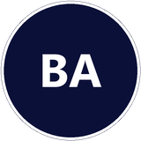
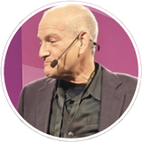

# Azure SRE Agent — Resources

This repository is the official community hub for Azure SRE Agent. Here you'll find:

- **🐛 Report Issues** — File bugs, feature requests, and feedback via [GitHub Issues](https://github.com/microsoft/sre-agent/issues)
- **📚 Resources** — Curated links to docs, videos, blogs, and community content for Azure SRE Agent
- **🧪 Labs** — Hands-on labs and sample environments to deploy, break, and fix apps with Azure SRE Agent (see the [`labs/`](labs/) folder)

---

## Why SRE Agent, and what is it?

Meet your AI teammate for cloud operations: investigate incidents, reduce operational toil, and move from reactive firefighting to proactive reliability.

- **[Why Azure SRE Agent? Watch the pitch](https://aka.ms/sreagent/pitchvideo)**
- **[See ZeroOps with Azure SRE Agent](https://aka.ms/sreagent/zeroops-video)**

## Come catch us at Microsoft Ignite 2026

**Azure SRE Agent at Microsoft Ignite 2026: every session & lab in one place.**

Moscone West, San Francisco. **All times PT.** Labs fill fast, so reserve early!

**[Register](https://register.ignite.microsoft.com/flow/microsoft/ignite27/welcome/page/welcome)**

### Visit the Agentic Operations booth

Stop by the Agentic Operations booth to meet the experts and see Azure SRE Agent demos.

Scan a session's QR code, or use the **Register** link below it.

<table>
  <tbody>
    <tr>
      <td align="center" valign="middle" width="190">
         
        <a href="https://register.ignite.microsoft.com/flow/microsoft/ignite27/welcome/page/welcome">Register</a>
      </td>
      <td valign="top">
        <h3>Plan, modernize, deploy, and operate with AI agents</h3>
        
<em>Assess, modernize, deploy, then let Azure SRE Agent run production.</em>

        <strong>PREL38 | Pre-Day Workshop</strong>
        
📅 <strong>Date:</strong> Monday, November 16, 2026 
        🕒 <strong>Time:</strong> 1:00-5:00 PM PT 
        📍 <strong>Location:</strong> Level 2, Room 2003

        <table>
          <tr>
            <td valign="top" width="33%">
              <a href="https://build.microsoft.com/en-US/speakers/1768245294609build26-1767923733240001J5fY"> Ayan Gupta</a> 
              AI Advocate, GitHub
            </td>
            <td valign="top" width="33%">
              <a href="https://dotnet.microsoft.com/en-us/conf/2026/speakers/matt-soucoup"> Matt Soucoup</a> 
              Principal DevRel Lead for .NET, Microsoft
            </td>
            <td valign="top" width="33%">
              <a href="https://ignite.microsoft.com/en-US/speakers/177730559163ignite27-1789073902246001ak91?source=/sessions/1787858594736001SLBb-1791588331687001Clb0"> Shamir Abdul Aziz</a> 
              Principal Product Manager, Microsoft
            </td>
          </tr>
        </table>
        <strong>Pre-Day add-on at registration.</strong> 
      </td>
    </tr>
    <tr>
      <td align="center" valign="middle" width="190">
         
        <a href="https://ignite.microsoft.com/en-US/sessions/1787856876073001h8ld-1791906446596001z4Up">Register</a>
      </td>
      <td valign="top">
        <h3>Hands-on: Modernize apps and databases and automate operations</h3>
        
<em>Modernize an app, break it, and watch Azure SRE Agent fix it live.</em>

        <strong>LAB720 | Hands-on Lab (75 min)</strong> 
        <strong>Multiple sessions (4 total, 75 minutes each)</strong> 
        
📅 <strong>Date:</strong> Tuesday-Thursday, November 17-19, 2026 
        🕒 <strong>Times (PT):</strong> 
        Tuesday, November 17: 2:00 PM 
        Wednesday, November 18: 8:30 AM 
        Thursday, November 19: 9:00 AM 
        Thursday, November 19: 2:45 PM 
        📍 <strong>Location:</strong> Level 3, Room 3020

        <table>
          <tr>
            <td valign="top" width="33%">
              <a href="https://build.microsoft.com/en-US/speakers/1768245294609build26-1767923733240001J5fY"> Ayan Gupta</a> 
              AI Advocate, GitHub
            </td>
            <td valign="top" width="33%">
              <a href="https://dotnet.microsoft.com/en-us/conf/2026/speakers/matt-soucoup"> Matt Soucoup</a> 
              Principal DevRel Lead for .NET, Microsoft
            </td>
            <td valign="top" width="33%">
              <a href="https://ignite.microsoft.com/en-US/speakers/177730559163ignite27-1789073902246001ak91?source=/sessions/1787858594736001SLBb-1791588331687001Clb0"> Shamir Abdul Aziz</a> 
              Principal Product Manager, Microsoft
            </td>
          </tr>
        </table>
      </td>
    </tr>
    <tr>
      <td align="center" valign="middle" width="190">
         
        <a href="https://ignite.microsoft.com/en-US/sessions/1787856637610001E284-1791587922010001F67f">Register</a>
      </td>
      <td valign="top">
        <h3>Build AI-native with Azure's agentic application platform</h3>
        
<em>Azure App Service, Azure Container Apps and Azure Functions for AI-native applications.</em>

        <strong>BRK423 | Breakout</strong>
        
📅 <strong>Date:</strong> Tuesday, November 17, 2026 
        🕒 <strong>Time:</strong> 3:15-4:00 PM PT

        <table>
          <tr>
            <td valign="top" width="33%">
              <a href="https://ignite.microsoft.com/en-US/speakers/177730559163ignite27-1788898920211001amdY"> Bilal Alam</a> 
              Technical Fellow, Microsoft
            </td>
            <td valign="top" width="33%">
              <a href="https://ignite.microsoft.com/en-US/speakers/177730559163ignite27-1780506654728001mkkG?source=/sessions/1787856637610001E284-1791587922010001F67f"> Nir Mashkowski</a> 
              Partner Director, Product Management, Microsoft
            </td>
            <td valign="top" width="33%">
              <a href="https://ignite.microsoft.com/en-US/speakers/177730559163ignite27-1769544269031001o6sa?source=/sessions/1787856637610001E284-1791587922010001F67f"> Paul Yuknewicz</a> 
              Member of Technical Staff, Microsoft
            </td>
          </tr>
          <tr>
            <td valign="top" width="33%">
              <a href="https://ignite.microsoft.com/en-US/speakers/177730559163ignite27-1791677596345001CmOx?source=/sessions/1787856637610001E284-1791587922010001F67f"> Bijoy Boban</a> 
              Associate Director, KPMG
            </td>
            <td valign="top" width="33%">
              <a href="https://ignite.microsoft.com/en-US/speakers/177730559163ignite27-1790625875908001pZbw?source=/sessions/1787856637610001E284-1791587922010001F67f"> Greg Homen</a> 
              AI Transformation Program Leader - Tax, KPMG LLP
            </td>
            <td></td>
          </tr>
        </table>
      </td>
    </tr>
    <tr>
      <td align="center" valign="middle" width="190">
         
        <a href="https://ignite.microsoft.com/en-US/sessions/1787856636396001ETO1-1791588269572001Cvn5">Register</a>
      </td>
      <td valign="top">
        <h3>Put AI agents to work in Azure cloud operations</h3>
        
<em>Agents that investigate incidents, cut costs and take corrective action.</em>

        <strong>BRK415 | Breakout</strong>
        
📅 <strong>Date:</strong> Wednesday, November 18, 2026 
        🕒 <strong>Time:</strong> 11:30 AM-12:15 PM PT

        <table>
          <tr>
            <td valign="top" width="33%">
              <a href="https://ignite.microsoft.com/en-US/speakers/177730559163ignite27-1768691145006001Si6c?source=/sessions/1787856636396001ETO1-1791588269572001Cvn5"> Brendan Burns</a> 
              Corporate Vice President and Technical Fellow, Microsoft
            </td>
            <td valign="top" width="33%">
              <a href="https://ignite.microsoft.com/en-US/speakers/177730559163ignite27-1788897034378001KXv8?source=/sessions/1787856636396001ETO1-1791588269572001Cvn5"> Ruhiyyih Mahalati</a> 
              VP, Engineering Azure Exp &amp; Platform, Microsoft
            </td>
            <td valign="top" width="33%">
              SRE Agent demo by <a href="https://build.microsoft.com/en-US/speakers/1768245294609build26-1778642541081001DHZz">Deepthi Chelupati</a> 
              Principal Product Manager, Microsoft
            </td>
          </tr>
        </table>
      </td>
    </tr>
    <tr>
      <td align="center" valign="middle" width="190">
         
        <a href="https://ignite.microsoft.com/en-US/sessions/1787858594736001SLBb-1791588331687001Clb0">Register</a>
      </td>
      <td valign="top">
        <h3>Deploy intelligent SRE for autonomous cloud ops</h3>
        
<em>Dynatrace + Azure SRE Agent + MCP with Microsoft Copilot.</em>

        <strong>THRSP1109 | Theater</strong>
        
📅 <strong>Date:</strong> Thursday, November 19, 2026 
        🕒 <strong>Time:</strong> 9:35-10:00 AM PT 
        📍 <strong>Location:</strong> Level 3, Theater A

        <table>
          <tr>
            <td valign="top" width="33%">
              <a href="https://ignite.microsoft.com/en-US/speakers/177730559163ignite27-1789073902246001ak91?source=/sessions/1787858594736001SLBb-1791588331687001Clb0"> Shamir Abdul Aziz</a> 
              Principal Product Manager, Microsoft
            </td>
            <td valign="top" width="33%">
              <a href="https://ignite.microsoft.com/en-US/speakers/177730559163ignite27-1788876321018001WYf3"> Ashley Adams</a> 
              Principal Product Marketing Manager, Dynatrace
            </td>
            <td valign="top" width="33%">
              <a href="https://ignite.microsoft.com/en-US/speakers/177730559163ignite27-1790872963026001Lcel?source=/sessions/1787858594736001SLBb-1791588331687001Clb0"> Laurenz Frost</a> 
              Cloud Solution Architect, Director, Commerzbank
            </td>
          </tr>
        </table>
      </td>
    </tr>
    <tr>
      <td align="center" valign="middle" width="190">
         
        <a href="https://ignite.microsoft.com/en-US/sessions/1787856636701001ERm4-1791588336506001CinE">Register</a>
      </td>
      <td valign="top">
        <h3>Scale operations, not toil, with your AI SRE teammate</h3>
        
<em>From reactive firefighting to proactive reliability.</em>

        <strong>BRK417 | Breakout: the main SRE Agent session</strong>
        
📅 <strong>Date:</strong> Thursday, November 19, 2026 
        🕒 <strong>Time:</strong> 4:00-4:45 PM PT

        <table>
          <tr>
            <td valign="top" width="33%">
              <a href="https://ignite.microsoft.com/en-US/speakers/177730559163ignite27-1780506654728001mkkG?source=/sessions/1787856637610001E284-1791587922010001F67f"> Nir Mashkowski</a> 
              Partner Director, Product Management, Microsoft
            </td>
            <td valign="top" width="33%">
              <a href="https://ignite.microsoft.com/en-US/speakers/177730559163ignite27-1788897460657001lOED?source=/sessions/1787856636701001ERm4-1791588336506001CinE"> Sanchit Mehta</a> 
              Principal Software Engineering Manager, Microsoft
            </td>
            <td valign="top" width="33%">
              <a href="https://ignite.microsoft.com/en-US/speakers/177730559163ignite27-1790780771713001dP4Z?source=/sessions/1787856636701001ERm4-1791588336506001CinE"> Babji Talluri</a> 
              Senior DevOps Engineer, InEight
            </td>
          </tr>
        </table>
      </td>
    </tr>
  </tbody>
</table>

**Not in SF?** The Digital pass is free, and breakouts are recorded. Come say hi!

---

## Quick Links

| Resource | Link |
|----------|------|
| Product Home Page | <https://www.azure.com/sreagent> |
| Portal (Create & Manage Agents) | <https://aka.ms/sreagent> |
| Documentation | <https://aka.ms/sreagent/newdocs> |
| Pricing & Billing | <https://aka.ms/sreagent/pricing> |
| Designing & Practicing ZeroOps using Azure SRE Agent | <https://aka.ms/sreagent/zeroops> |
| All Blogs | <https://aka.ms/sreagent/blog> |
| YouTube Channel | <https://aka.ms/sreagent/youtube> |
| GitHub — Azure SRE Agent (Report Issues, Official Labs & Resources) | <https://aka.ms/sreagent/github> |
| Hands-on Lab | <https://aka.ms/sreagent/lab> |
| Request a New Region | <https://aka.ms/sreagent/region> |
| GitHub — Official Plugins | <https://github.com/Azure/sre-agent-plugins> |
| Tech Community Discussions | <https://aka.ms/sreagent/discussions> |
| Agentic DevOps Live | <https://aka.ms/agenticdevopslive> |
| X (Twitter) | <https://x.com/azuresreagent> |

---

## Featured Videos

### Azure SRE Agent: End to End Agentic Operations Platform for Any Kind of Toil at Enterprise Scale
A comprehensive look at Azure SRE Agent as an end-to-end agentic operations platform — covering how it tackles every kind of operational toil and scales to meet enterprise needs.
🔗 <https://www.youtube.com/watch?v=06j-d0gsREw>

### What is Azure SRE Agent — Official Overview
The official Microsoft Azure product overview — a concise explainer of what Azure SRE Agent is, how it works, and the problems it solves.
🔗 <https://www.youtube.com/watch?v=6vDrThUjDOc> · 6,156 views · 158 likes

### Microsoft AI SRE Agent: Fixing Bugs While You Sleep
Satya Nadella highlights Azure SRE Agent as a key example of AI-driven operations transforming how engineering teams manage reliability at scale.
🔗 <https://www.youtube.com/watch?v=3hPeKDtLvPg> · 2,548 views · 26 likes

### Azure SRE Agent: Less Toil, More Uptime, Maximum Innovation — Azure Friday
Scott Hanselman walks through Azure SRE Agent on Azure Friday, showing how it reduces operational toil and lets teams focus on innovation.
🔗 <https://www.youtube.com/watch?v=5c9pl8_DI3w> · 4,264 views · 75 likes

### Root Cause Analysis with Code Context: Azure SRE Agent + GitHub Integration — GA Launch
The GA launch video demonstrating Azure SRE Agent performing root cause analysis with full code context through deep GitHub integration.
🔗 <https://www.youtube.com/watch?v=1vKoxPeep_M> · 582 views · 25 likes

### Use Azure SRE Agent to Automate Tasks and Increase Site Reliability (DEM550) — Build
Deep-dive Build session covering end-to-end SRE Agent capabilities: automated investigation, remediation, proactive monitoring, and custom hooks.
🔗 <https://www.youtube.com/watch?v=bK3SIQoE_Nc> · 12,294 views · 129 likes

---

## More Videos

- [Fix It Before They Feel It: Proactive .NET Reliability with Azure SRE Agent](https://www.youtube.com/watch?v=Kx_6SB-mhgg) — dotnet · 1,466 views
- [Azure SRE Agent - Incident Management with PagerDuty](https://www.youtube.com/watch?v=5wrArcKzUaI) — Azure SRE Agent (official) · 547 views
- [Azure SRE Agent - Your 24/7 Automated Response Team](https://www.youtube.com/watch?v=xNTvYAoWvLU) — Mariusz Ferdyn · 313 views
- [Azure's New SRE Agent Is INSANE — Here's Why you Should Pay Attention](https://www.youtube.com/watch?v=2QdTfBZiASc) — TechTalks with Gil · 249 views
- [SRE Agent Series: What Is Azure SRE Agent and How to Create One Step by Step](https://www.youtube.com/watch?v=dvkfsbF0wmM) — JBSWiki · 204 views
- [Azure SRE Agent Explained](https://www.youtube.com/watch?v=B93WmYLQ6PE) — Cloud Talk with Jonnychipz · 160 views
- [SRE Agent Series: I Let an Azure SRE Agent Manage My Subscription — Here's What Happened](https://www.youtube.com/watch?v=rfwRvTTej-o) — JBSWiki · 143 views
- [Agentic DevOps: Azure SRE Agent with GitHub Copilot Coding Agent demo](https://www.youtube.com/watch?v=ZrpxNkUQ0C8) — Jorge Balderas · new

---

## Blogs

### //Build 2026 (May 2026)

- **[Azure SRE Agent at Microsoft //Build 2026](https://aka.ms/Build26/blog/SREAgent)** — Headline //Build announcement and roadmap for what's next in Azure SRE Agent.
- **[VNet Integration for Azure SRE Agent](https://aka.ms/sreagent/blog/VNET)** — Secure private network connectivity so the agent can investigate workloads in locked-down VNets.
- **[Hooks and Tool Permissions](https://aka.ms/sreagent/blog/HooksAndToolPermissions)** — New governance controls to customize agent behavior and gate which tools it can use.
- **[Private Plugin Marketplace](https://aka.ms/sreagent/blog/privatepluginmarketplace)** — Publish and distribute internal plugins to your organization with full lifecycle management.
- **[GitHub Enterprise Support](https://aka.ms/sreagent/blog/githubenterprise)** — Native integration for GitHub Enterprise Cloud and GHE Server customers.
- **[Connectors v2](https://aka.ms/sreagent/blog/connectorsv2)** — Next-generation connector framework with improved auth, schema, and lifecycle.

**//Build Session:** [Using autonomous SRE to move from alerts to action (OD800)](https://build.microsoft.com/en-US/sessions/OD800)

### Post-GA (April 2026)

- **[Event-Driven IaC Operations: Terraform Drift Detection via HTTP Triggers](https://techcommunity.microsoft.com/blog/appsonazureblog/event-driven-iac-operations-with-azure-sre-agent-terraform-drift-detection-via-h/4512233)** — Vineela Suri · 10 min read. End-to-end pipeline: Terraform Cloud webhook triggers SRE Agent to classify drift as benign/risky/critical, correlate with incidents, and ship a fix — including a "DO NOT revert" recommendation that prevents turning a mitigated incident into an outage.
- **[Managing Multi-Tenant Azure Resources with SRE Agent and Lighthouse](https://techcommunity.microsoft.com/blog/appsonazureblog/managing-multi%E2%80%91tenant-azure-resource-with-sre-agent-and-lighthouse/4511789)** — Pranab Mandal · 6 min read. Step-by-step guide to configuring Azure Lighthouse delegation so a single SRE Agent can monitor and manage resources across multiple tenants — covering ARM templates, RBAC roles, and managed identity setup.
- **[New in Azure SRE Agent: Log Analytics and Application Insights Connectors](https://techcommunity.microsoft.com/blog/appsonazureblog/new-in-azure-sre-agent-log-analytics-and-application-insights-connectors/4509649)** — Dalibor Kovacevic · 3 min read. Native MCP-backed connectors for Log Analytics and App Insights — connect a workspace, auto-grant RBAC, and the agent queries ContainerLog, Syslog, exceptions, and traces directly during investigations.
- **[Azure Monitor in Azure SRE Agent: Autonomous Alert Investigation and Intelligent Merging](https://techcommunity.microsoft.com/blog/appsonazureblog/azure-monitor-in-azure-sre-agent-autonomous-alert-investigation-and-intelligent-/4509069)** — Vineela Suri · 9 min read. Full walkthrough of Azure Monitor integration: Incident Response Plans, alert merging (7 firings → 1 thread), auto-resolve trade-offs, and a live AKS + Redis scenario where the agent fixes a bad credential autonomously.
- **[3 Ways to Get More from Azure SRE Agent](https://techcommunity.microsoft.com/blog/appsonazureblog/3-ways-to-get-more-from-azure-sre-agent/4508993)** — dchelupati · 4 min read. Practical cost and value tips: start narrow with incident routing, replace high-frequency polling with push/batch patterns, and keep scheduled task threads fresh with "new chat thread for each run."
- **[How We Build and Use Azure SRE Agent with Agentic Workflows](https://techcommunity.microsoft.com/blog/appsonazureblog/how-we-build-and-use-azure-sre-agent-with-agentic-workflows/4508753)** — Shamir AbdulAziz · 6 min read. Customer Zero blog: how Microsoft embedded agents across the SDLC to build SRE Agent — 35K+ incidents handled, 50K+ developer hours saved, App Service time-to-mitigation down from 40.5 hours to 3 minutes.
- **[An Update to the Active Flow Billing Model](https://aka.ms/sreagent/pricing/blog)** — Mayunk Jain · 3 min read. Active flow billing moves from time-based to token-based usage, with per-model-provider AAU rates. Always-on pricing unchanged at 4 AAUs per agent-hour.

### GA Launch (March 2026)

- **[Announcing General Availability for the Azure SRE Agent](https://aka.ms/sreagent/ga)** — Mayunk Jain · 4 min read. GA announcement: 1,300+ agents deployed internally at Microsoft, 35K+ incidents mitigated, 20K+ engineering hours saved. Covers deep context, built-in computation, memory and learning, and Ecolab customer story.
- **[What's New in Azure SRE Agent in the GA Release](https://aka.ms/sreagent/blog/whatsnewGA)** — dchelupati · 2 min read. Companion to the GA announcement: redesigned onboarding, deep context, code interpreter, memory, skills, subagents, Python tools, agent hooks, and MCP connectors.
- **[The Agent That Investigates Itself (SRE4SRE)](https://aka.ms/sreagent/blogs/sre4sre)** — Sanchit Mehta · 11 min read. Deep technical post — the SRE Agent investigating its own KV cache regression, demonstrating how the team uses the product to maintain the product.
- **[Azure SRE Agent Now Builds Expertise Like Your Best Engineer (Deep Context)](https://aka.ms/sreagent/blogs/deepcontextblog)** — dchelupati · 6 min read. How the agent operates with continuous access to source code, persistent memory across investigations, and background intelligence that runs when nobody is asking questions.
- **[What It Takes to Give SRE Agent a Useful Starting Point (Onboarding)](https://aka.ms/sreagent/blogs/onboardingtosrea)** — Dalibor Kovacevic · 10 min read. Designing the guided onboarding flow: connecting code, logs, incidents, Azure resources, and knowledge files so a new agent becomes useful on day one.
- **[Agent Hooks: Production-Grade Governance for Azure SRE Agent](https://aka.ms/sreagent/blogs/agenthooks)** — Vineela Suri · 9 min read. Governance primitives for controlling agent behavior: stop hooks, PostToolUse hooks, and global hooks that enforce approval gates and safety boundaries.
- **[An AI-Led SDLC: Building an End-to-End Agentic Software Development Lifecycle with Azure and GitHub](https://techcommunity.microsoft.com/blog/appsonazureblog/an-ai-led-sdlc-building-an-end-to-end-agentic-software-development-lifecycle-wit/4491896)** — owaino · 16 min read. Full agentic SDLC walkthrough: Spec-Kit → GitHub Coding Agent → Code Quality → CI/CD → SRE Agent — with the SRE Agent closing the loop by opening GitHub issues for the coding agent to fix.

### Pre-GA (December 2025)

- **[Context Engineering: Lessons from Building Azure SRE Agent](https://techcommunity.microsoft.com/blog/appsonazureblog/context-engineering-lessons-from-building-azure-sre-agent/4481200)** — Sanchit Mehta · 8 min read. Engineering lessons: started with 100+ tools and 50+ specialized agents, ended with 5 core tools and generalist agents — why less is more in agent design.

---

## GitHub Repos

| Repo | Stars | Description |
|------|------:|-------------|
| [microsoft/sre-agent](https://github.com/microsoft/sre-agent) | 83 | Official hands-on lab — sample environments, walkthroughs, and prompt guides |
| [matthansen0/azure-sre-agent-sandbox](https://github.com/matthansen0/azure-sre-agent-sandbox) | 52 | Fully automated sandbox deployment with AKS break-fix scenarios |
| [paulasilvatech/Agentic-Ops-Dev](https://github.com/paulasilvatech/Agentic-Ops-Dev) | 23 | Agentic Operations & Observability Workshop |
