# Caldova Retail Ops — Azure SRE Agent lab

Act as the on-call engineer for Caldova Retail Co., a storefront and operations app running on Azure App Service. Understand the app, investigate a customer-visible search failure, verify recovery, automate recurring work, and build interactive operational views with Azure SRE Agent.

One `azd up` deploys everything into your subscription: the Caldova web app (with the search failure already in place), monitoring, and an SRE Agent connected to it.

## Architecture


- **Application:** the Caldova storefront (.NET 8) runs on a Windows App Service plan. A forward-dated `Catalog__AsOfDate` setting breaks product search; browsing still works.
- **Observability:** the app sends requests, exceptions, and traces to Application Insights, and App Service logs and metrics to Log Analytics. Availability tests generate steady traffic, and metric alerts watch failures and availability.
- **Azure SRE Agent:** runs as a user-assigned managed identity with Contributor on the resource group and Reader on the subscription. Connectors give it Log Analytics and Application Insights. It starts in **Review** mode, so you approve its actions.
- **You:** work with the agent at [sre.azure.com](https://sre.azure.com) as **SRE Agent Administrator**. During setup you create a private GitHub copy of the app source; in exercise 3 you connect it so the agent can relate failures to code.

## What gets deployed

The lab resources go into one resource group, `rg-<environment-name>`:

| Resource | Purpose |
|---|---|
| App Service plan (Windows, `P0v3`) and web app `caldova-webapp-<suffix>` | The Caldova storefront (.NET 8) from [`src/`](src/) |
| Application Insights and Log Analytics workspace | Request telemetry, App Service logs, and metrics |
| 12 availability tests and metric alerts | Steady background traffic and failure/availability signals |
| Azure SRE Agent `caldova-sreagent-<suffix>` | Scoped to the resource group, with Application Insights and Log Analytics connected |
| User-assigned managed identity | Agent identity: **Contributor** on the resource group, plus **Reader** on the subscription |

You also get the **SRE Agent Administrator** role on the agent so you can open it.

## Before you start

- An **Azure subscription** where you have **Owner**, or **Contributor** + **User Access Administrator**.
- A **GitHub account**. Sign up at <https://github.com/signup> if needed.

The deployed resources and the SRE Agent incur charges until you [clean up](#clean-up).

## Set up (10–25 minutes)

About 10 minutes if the tools are already installed; up to 25 minutes on a new machine.

### Step 1. Install prerequisites

Run one command. It installs anything missing (Git, Azure CLI, Azure Developer CLI, .NET SDK 8 or later, GitHub CLI), signs you in to GitHub and Azure, checks your subscription permissions, and registers the `Microsoft.App` resource provider. It's safe to run again.

macOS or Linux (Terminal):

```bash
bash <(curl -fsSL https://raw.githubusercontent.com/microsoft/sre-agent/main/labs/caldova-retail-ops/setup.sh)
```

Windows (PowerShell):

```powershell
irm https://raw.githubusercontent.com/microsoft/sre-agent/main/labs/caldova-retail-ops/setup.ps1 | iex
```

Browser windows open for the GitHub and Azure sign-ins. On macOS, installing Homebrew or the .NET SDK asks for your Mac password.

### Step 2. Clone the repository

```bash
git clone https://github.com/microsoft/sre-agent.git
cd sre-agent/labs/caldova-retail-ops
```

### Step 3. Deploy

```bash
azd up
```

When prompted, enter an environment name such as `caldova-<your-alias>`, select your subscription, and select a region such as `eastus2`. Deployment takes about 5 minutes and prints your storefront URL. To see your values again later, run `azd env get-values` (`WEB_APP_URL` and `SRE_AGENT_NAME`).

<details>
<summary>Optional: change the agent region or App Service plan size</summary>

Run these before `azd up`. The agent defaults to `eastus2`; use another [supported region](https://learn.microsoft.com/azure/sre-agent/supported-regions) if needed. Use `B1` or higher if `P0v3` quota is unavailable.

```bash
azd env new caldova-<your-alias>
azd env set SRE_AGENT_LOCATION swedencentral
azd env set APP_SERVICE_PLAN_SKU B1
```

</details>

### Step 4. Copy the app source to a private GitHub repository

The agent uses this repository to relate failures to code. From the `labs/caldova-retail-ops` folder:

macOS or Linux:

```bash
cp -R src ~/caldova-retail-ops
cd ~/caldova-retail-ops
```

Windows (PowerShell):

```powershell
Copy-Item -Recurse src $HOME\caldova-retail-ops
cd $HOME\caldova-retail-ops
```

Then, on any OS:

```bash
git init -b main
git add .
git commit -m "Caldova Retail Ops"
gh repo create caldova-retail-ops --private --source . --push
```

Copy the repository URL that `gh` prints. You connect it to the agent in exercise 3.

> [!NOTE]
> Wait 10–15 minutes after `azd up` finishes before exercise 4, so availability tests generate telemetry and the agent builds its context. Exercises 1–3 can start right away.

## Your path

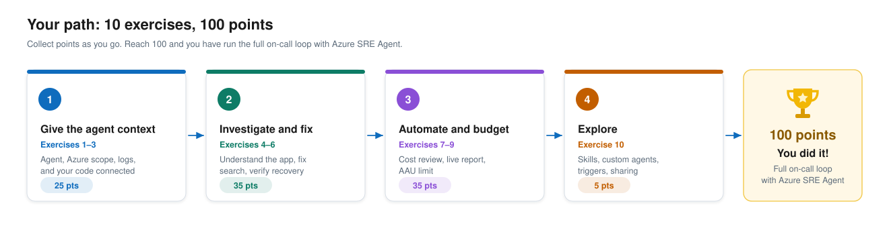

| Stage | Exercises | What you'll have at the end | Points |
| ----- | --------- | --------------------------- | -----: |
| Give the agent context | 1-3 | Your repository copy connected to the agent alongside its Azure scope and logs | 25 |
| Investigate and fix | 4-6 | A working product search, verified in the app yourself | 35 |
| Automate and budget | 7-9 | A weekly cost review, a live health report, and a clear view of the AAU limit | 35 |
| Explore | 10 | Report versions, detailed usage, Agent Canvas, skills, custom agents, integrations, and triggers | 5 |
| **Total** | | | **100** |

### Scorecard

Each exercise ends with a **Points** line. Award yourself the points when you meet it.

| # | Exercise | Points |
| -: | -------- | -----: |
| 1 | Open Azure SRE Agent | 5 |
| 2 | Review Azure resources and telemetry | 5 |
| 3 | Connect your repository | 15 |
| 4 | Review the Getting started thread | 5 |
| 5 | Inquire and configure Web App | 5 |
| 6 | Debug the product-search failure | 25 |
| 7 | Schedule a weekly cost review | 15 |
| 8 | Create a live traffic and health report | 15 |
| 9 | Review agent consumption and the AAU budget | 5 |
| 10 | Explore agent capabilities | 5 |
| | **Total** | **100** |

**Keep work moving:** Agent replies, task creation, report authoring, and scheduled runs can take several minutes. Answer pending questions or approvals, then continue an independent exercise instead of waiting. Do not submit duplicate requests.

## 1. Open Azure SRE Agent (5 points)

**Goal:** Open the deployed agent and see how its context is assembled.

1. Open <https://sre.azure.com> and sign in with the Azure account you used for `azd up`.
2. In the agent list, select `caldova-sreagent-<suffix>` (the `SRE_AGENT_NAME` value from `azd env get-values`). Use this agent throughout the lab; do not create another.

   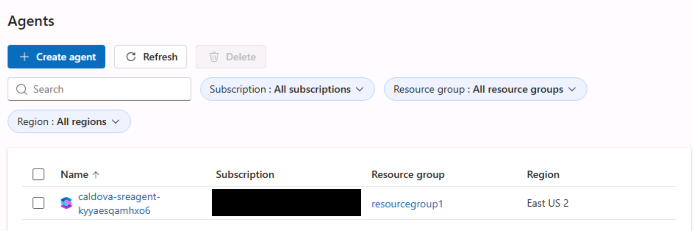

3. On **More context. Better investigations.**, keep **Quickstart** selected and the **context wizard** open. Review resources and connect your repository in the next exercises before selecting **Done and go to agent**.

   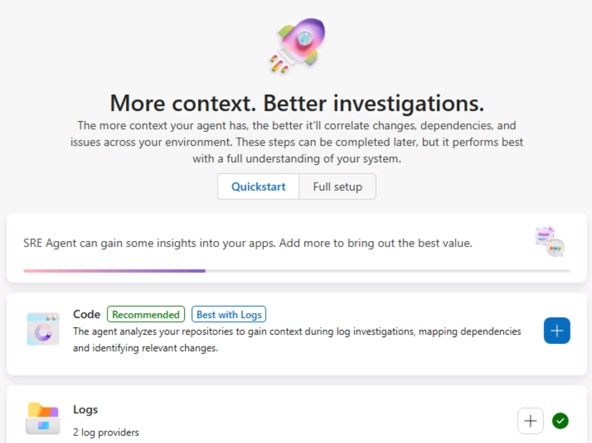

**Points: 5.** You opened your agent at sre.azure.com and the context wizard is showing.

## 2. Review Azure resources and telemetry (5 points)

**Goal:** Understand which resource group and log sources the agent uses.

Azure resource scope tells the agent what it may inspect; connected logs provide the evidence for health, traffic, and failure analysis.

If the context wizard is closed, go to **Operations hub > Overview > Complete setup**.

1. Under **Azure resources**, click **Show details**. Review the configured **Resource group** (`rg-<environment-name>`). Leave it unchanged.
2. Under **Logs**, click **Show details**. Confirm **Application Insights** and **Log Analytics** both show **Connected**.

   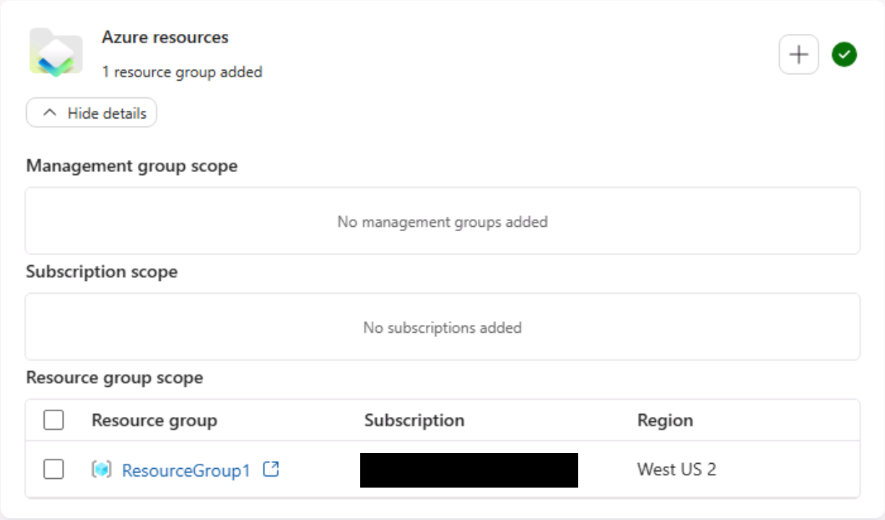

   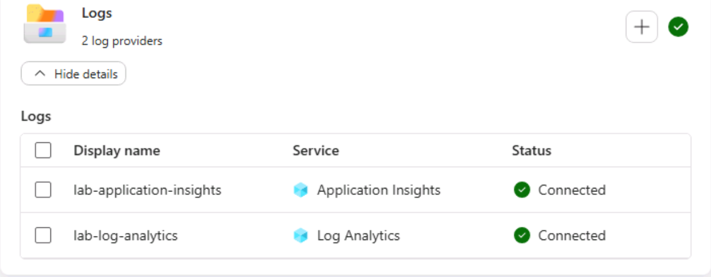

**Points: 5.** You confirmed the resource group scope and that Application Insights and Log Analytics show **Connected**.

## 3. Connect your repository (15 points)

**Goal:** Connect your repository so the agent can investigate the application source.

1. In the **same context wizard**, under **Code**, click **+**. Select **GitHub** and paste your repository URL into **Repository URL**.
2. Scroll to **Connection method**. Keep **OAuth**, then click **Sign in to GitHub**. Confirm the account, review access, and click **Authorize Azure-SRE-Agent**. When **Connected to GitHub** appears, click **Next**.
3. Under **Add repositories**, confirm your repository URL, then click **Save**.
4. Under **Code**, click **Show details** and confirm the repository appears.

   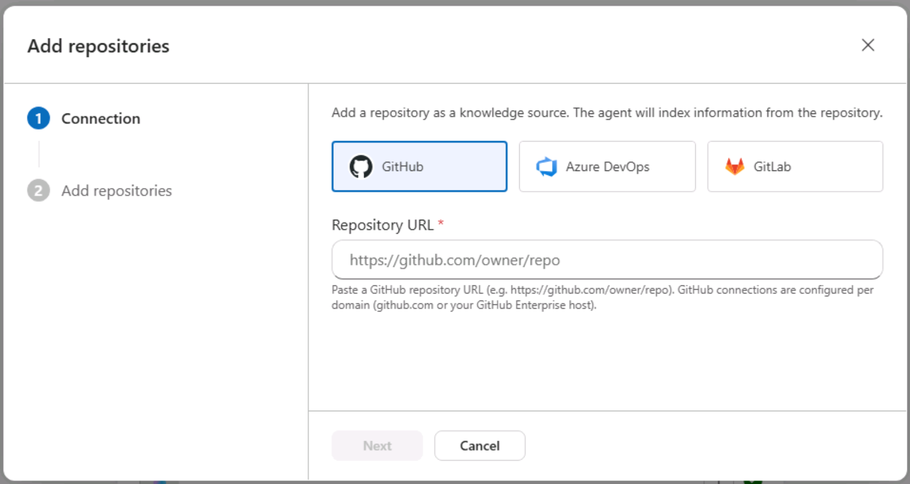

   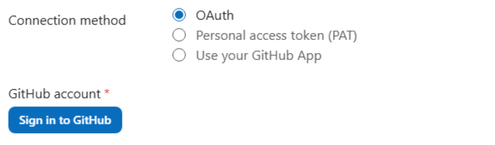

   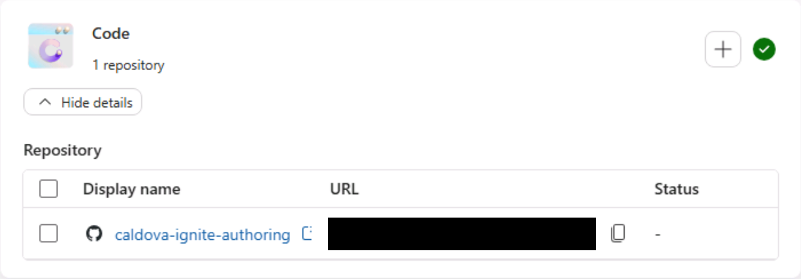

If the agent reports that indexing is still running, continue another exercise and return later.

**Points: 15.** Your repository appears under **Code > Show details**.

## 4. Review the Getting started thread (5 points)

**Goal:** Understand what Caldova does and how its Azure resources fit together.

1. In the context wizard, click **Done and go to agent**, then review your **Getting started** thread. If you can't find it, select **Search Threads** and search `get to know`.
2. Answer any open questions from the agent, then review the application summary, architecture diagram, and health findings.
3. Ask your own question about the app, or start with this one:

   ```text
   What is this app about, and what can customers do with it?
   ```

   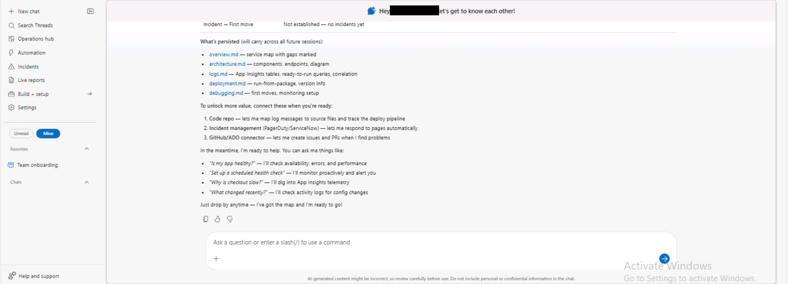

   *Example only; your thread and generated answers will differ.*

Spend up to 5 minutes here, then continue.

**Points: 5.** You can describe what Caldova does and which Azure resources it uses.

## 5. Inquire and configure Web App (5 points)

**Goal:** Inspect and understand the App Service configuration.

Knowing the hosting settings and the website address helps you distinguish configuration choices from application-code failures.

1. Select **New chat** and enter:

   ```text
   List the configuration of the Caldova App Service and provide the full HTTPS link to its website.
   ```

2. Review the configuration and ask about any unfamiliar settings.
3. Open the website link in a new browser tab and confirm the app loads. It should match `WEB_APP_URL` from `azd env get-values`.

   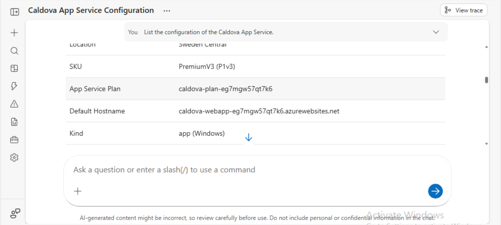

**Points: 5.** You opened the website from the link the agent gave you.

## 6. Debug the product-search failure (25 points)

**Goal:** Investigate the search problem, fix it, and confirm customer-visible recovery.

A proposed patch is not the outcome: customers must be able to find products again.

1. Open the website, select **Catalog**, and confirm browsing works. Under **Search by product name**, enter `jacket` and click **Search**. Observe **500 - Search failed**.

   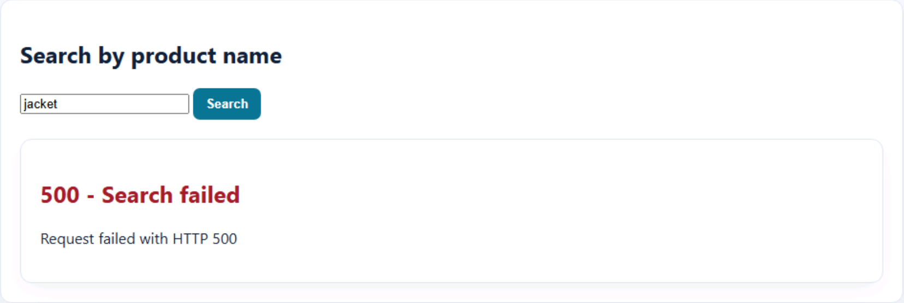

2. In SRE Agent, select **New chat** and enter:

   ```text
   Product search fails with HTTP 500, but browsing works. Find out why, fix the running app, and check that searching for jacket returns products.
   ```

3. Follow the investigation and answer the agent's questions and approvals.
4. Repeat the `jacket` search. Confirm matching products appear and catalog browsing still works.

**Check yourself:** Can you say in one sentence what caused the failure and what changed to fix it? If not, ask the agent to summarize the root cause and the change it made.

A source-code pull request is not a deployment. If the running app still fails after a proposed fix, tell the agent what still fails and ask it to investigate further. An empty result set is not recovery.

**Points: 25.** Searching for `jacket` returns products, catalog browsing still works, and you can state the root cause in one sentence.

## 7. Schedule a weekly cost review (15 points)

**Goal:** Use chat to automate cost analysis, forecasting, and savings recommendations.

**Scheduled tasks** turn recurring work into automatic flows: NSG-rule and RBAC audits, vulnerability reviews, FinOps reviews, anomaly detection, operational reporting, and proposed code changes with human review. Here you automate a read-only weekly cost review.

> [!NOTE]
> A freshly deployed lab has little cost history. Forecasts should state their assumptions.

1. Select **New chat** and enter:

   ```text
   Create a weekly scheduled task called "Weekly Caldova cost review" and run it once now. Review current Azure costs for this lab's resource group, forecast next month, and recommend savings. Produce a self-contained HTML slide deck with charts, tables, and clear visuals for cost drivers, forecasts, and savings. Use available data, label estimates and assumptions, and do not change any resources.
   ```

2. Answer any questions from the agent. Task creation can take several minutes; start exercise 8 and return later.
3. **After the agent confirms the task exists**, select **Automation > Weekly Caldova cost review**. Check its schedule and latest run status. If no run has started, select **Run task now** once.

   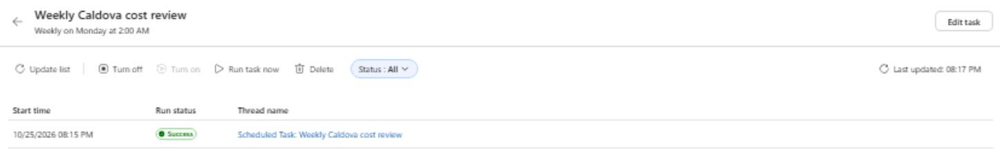

4. Later, open the task's latest execution thread, review the findings, and download and open the HTML slide deck. The run has its own thread, separate from the chat that created the task.

   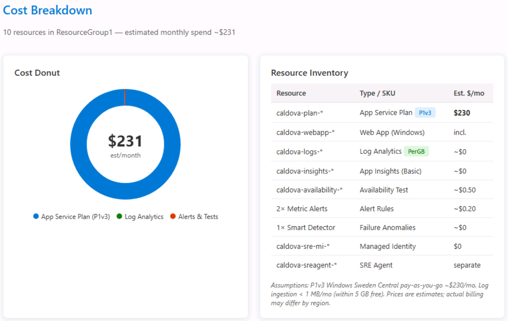

   *Example amounts only; your data and layout will differ.*

**Points: 15.** You opened the HTML slide deck from the task's execution thread.

## 8. Create a live traffic and health report (15 points)

**Goal:** Build and use an interactive UI through conversation.

**Live Reports are a UI for AI, not just dashboards.** Describe an interactive application in chat, then refine it with the agent. The connected data, tools, and permissions determine what it can read or do.

1. Select **Live reports > + New report**.
2. When the agent asks what report you want, select **Enter a custom response** and enter:

   ```text
   1. Create a live report called "Caldova Traffic and Health" using 24 hours of connected telemetry. Before the metric cards, draw a dependency graph using Azure service SVG icons inside circular health-colored rings, not text-only rectangles. Include a legend; label unknown health and inferred connections. Where supported, make nodes clickable for service health and metrics/logs; do not invent links. Below, show request counts, failure rate, response times, top requested/failing URLs, and geography where available. Use interactive charts and filters where supported, use a responsive layout, label missing data, and keep it read-only.
   2. Build the page in a few smaller steps (layout and styling first, then the dependency graph, then the charts and tables) instead of writing it all at once.
   3. Draw each Azure icon once and reuse it. Ensure the report is built quickly and the report is performant
   ```

3. Answer any further questions. Review the report-saving approval and allow only the expected read-only telemetry tools.
4. Report authoring can take several minutes. Return to exercise 7 meanwhile.
5. Open **Live reports > Caldova Traffic and Health** once saved. Review the dependency graph, then the charts and tables. If a node offers a drill-down, click it; details may open below the graph. If the layout differs from your request, use **Open authoring thread** to correct the existing report rather than creating a duplicate.

   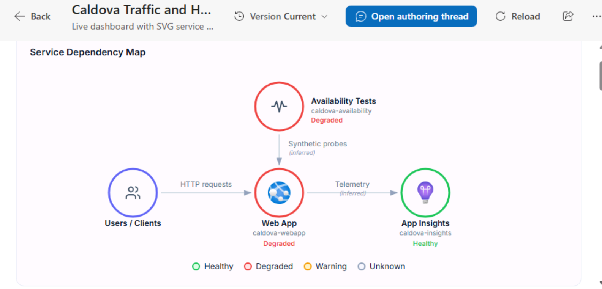

   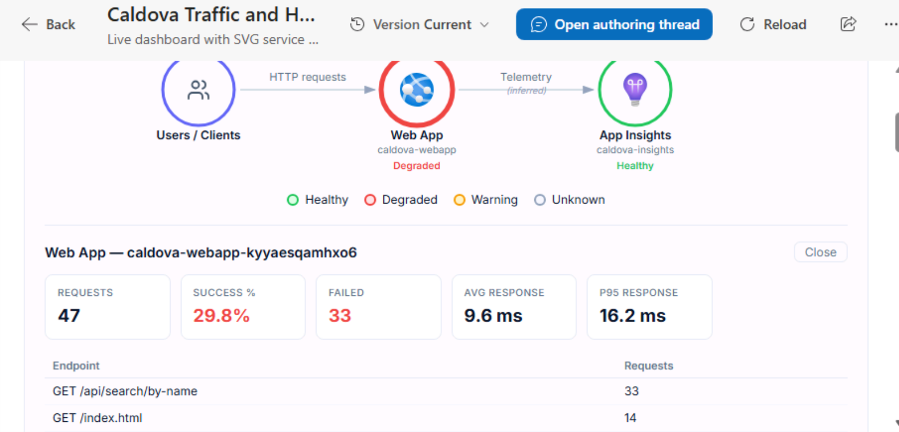

   If telemetry is empty, browse the app and try search, then return later. The 24-hour report can still show earlier failures after a fix.

   **Generic symbols instead of Azure icons, or graph too tall?** In the report's authoring thread, enter:

   ```text
   Replace only the Web App and App Insights glyphs with these Azure SVGs inside the existing health rings. Preserve click handlers and queries. Cap graph height at 400px without distortion. Save a new version, not a new report. Web App: https://raw.githubusercontent.com/microsoft/sre-agent/main/labs/caldova-retail-ops/docs/images/azure-app-service.svg App Insights: https://raw.githubusercontent.com/microsoft/sre-agent/main/labs/caldova-retail-ops/docs/images/azure-application-insights.svg
   ```

   These Microsoft icons are supplied unchanged under the [Azure icon terms](https://learn.microsoft.com/azure/architecture/icons/#icon-terms).

   > **Important:** If the report fails to load or behaves unexpectedly, describe the behavior or share screenshots in the same conversation so the agent can refine it.

**Points: 15.** The **Caldova Traffic and Health** report shows the dependency graph, charts, and tables.

## 9. Review agent consumption and the AAU budget (5 points)

**Goal:** Understand how an AAU limit makes agent spending predictable, controlled, and visible.

1. Select **Build + setup > Monitor > Agent consumption** (or **Settings > Agent consumption** in the earlier navigation). Locate **Monthly AAU limit** and current active-flow usage.

   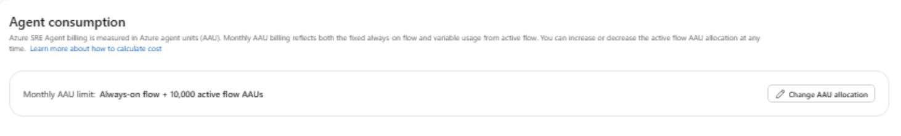

2. Select **Change AAU allocation**, inspect the monthly active-flow allowance, then select **Cancel**.

   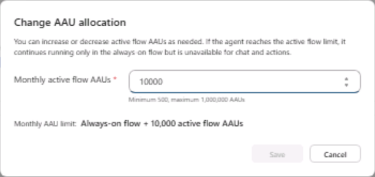

3. Review **Total active flow consumption**, **Daily active flow consumption**, and the **Chats** and **Scheduled tasks** breakdown.
4. Scroll to **Consumption by thread** and scan **Thread type**, **AAUs**, and **Status**.

   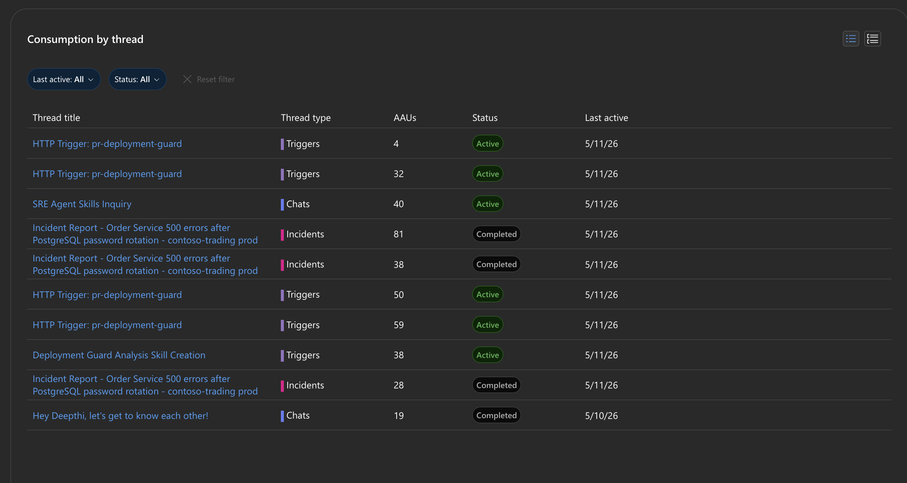

   *Reference screenshot: Microsoft, [Monitor agent usage](https://learn.microsoft.com/azure/sre-agent/monitor-agent-usage), [CC BY 4.0](https://creativecommons.org/licenses/by/4.0/), reproduced unchanged.*

5. When the active-flow limit is reached, chat and actions stop until allowance is available again. The fixed **always-on** charge is separate and continues while the agent exists. Usage can lag; select **Refresh** before concluding a thread is missing.

**Points: 5.** You can explain how the AAU limit keeps agent spending predictable, controlled, and visible.

## 10. Explore agent capabilities (5 points)

### Additional resource scopes and log connectors

Reopen the context wizard. Click **+** under **Azure resources** and under **Logs** to see what else you could connect. Cancel without adding anything.

### App Service Health check

In the exercise 5 thread, enter:

```text
Explain the Caldova App Service Health check setting and how /api/health could be used. Compare it with checking product search. Inspect only; do not change any settings.
```

A working `/api/health` does not prove that product search works.

### Live Report versions and sharing

Open **Live reports > Caldova Traffic and Health** and the **version picker**. Versions preserve layout and configuration, not historical telemetry. **Copy link to report** shares only with people who already have access to the agent.

### Detailed AAU usage

In **Agent consumption**, filter by **Chats** or **Scheduled tasks**, open a completed thread to review its steps and tool calls, and use **Download** to export the filtered threads as CSV.

### Agent Canvas and Skill Builder

Explore **Build + setup > Agent Canvas** and **Skills**. You don't need to write skill files manually — chat with the agent. For example:

```text
Help me build a reusable skill for troubleshooting web-service issues. Cover HTTP errors, latency, timeouts, DNS/TLS, application and dependency logs, recent changes, and testing recovery from the user's perspective. Ask about my environment and team procedures, draft the skill, and help me refine it before I create and try it. Do not change application resources.
```

| Capability | Why you would use it | Caldova example |
| ---------- | -------------------- | --------------- |
| Skill | Reusable instructions or a runbook the agent loads when relevant | A web-service troubleshooting procedure |
| Custom agent | A focused specialist with its own instructions, skills, and tools | A web-service troubleshooting or FinOps specialist |
| Connector | An authenticated connection to a data or service surface | Azure telemetry, your GitHub repository, an incident platform |
| Tool | A specific operation the agent can perform | Query request failures, inspect an NSG, propose a pull request |
| Policy | Constrains behavior and approval boundaries | Require human review before a deployment or RBAC change |
| Hook | Runs configured logic at supported lifecycle points | An organization-specific pre-action check or post-action audit record |

### Incident management and HTTP triggers

Open **Incidents** to see supported incident platforms, and **Incidents > Triggers + response plans** to see how alerts route to investigations. Scheduled tasks run by time; incident triggers react to alerts; HTTP triggers react to an explicit request from another system. Treat HTTP trigger callback URLs as credentials.

**Points: 5.** You tried at least two of the capabilities above, for example a skill draft and the live report version picker.

## Complete

Add up your scorecard. To reach 100 points:

- [ ] Searching for `jacket` returns products, and catalog browsing still works.
- [ ] You've opened the cost review's HTML slide deck from its execution thread.
- [ ] You've used the **Caldova Traffic and Health** live report.
- [ ] You can explain how the AAU limit keeps agent spending predictable, controlled, and visible.
- [ ] You've explored at least two capabilities from exercise 10.

<details>
<summary><strong>Scored 100 points? Open this.</strong></summary>

### 🏆 You did it!

You ran the full on-call loop with Azure SRE Agent: you gave it context, investigated a customer-facing failure, fixed it and verified recovery, automated recurring work, and kept agent spending under control.

Next, try it on your own services: connect a real resource group, your repository, and your incident platform at [sre.azure.com](https://sre.azure.com).

</details>

## Reset the search failure

To run exercise 6 again, re-apply the faulty setting:

```bash
az webapp config appsettings set \
  -g "$(azd env get-value AZURE_RESOURCE_GROUP)" \
  -n "$(azd env get-value WEB_APP_NAME)" \
  --settings Catalog__AsOfDate=2099-12-15
```

## Clean up

The web app, availability tests, and the agent's always-on flow incur charges while deployed. The subscription-level Reader role assignment is outside the resource group, so remove it separately before deleting the lab:

```bash
az login
az role assignment delete --ids "$(azd env get-value SRE_AGENT_READER_ROLE_ASSIGNMENT_ID)"
azd down --purge
```

On PowerShell, use `az role assignment delete --ids (azd env get-value SRE_AGENT_READER_ROLE_ASSIGNMENT_ID)` for the second command. `azd down` deletes the lab resource group but does not remove the subscription-level role assignment.

## Reference

- [Agent consumption](https://learn.microsoft.com/azure/sre-agent/monitor-agent-usage) and [AAU limits and billing](https://learn.microsoft.com/azure/sre-agent/pricing-billing#set-an-active-flow-spending-limit)
- [Create a skill](https://sre.azure.com/docs/tutorials/automation/create-skill) and [Create a custom agent](https://sre.azure.com/docs/tutorials/automation/create-subagent)
- [Connect Azure Monitor and automate incidents](https://sre.azure.com/docs/get-started/automate-incidents) and [Configure a response plan](https://sre.azure.com/docs/tutorials/agent-config/setup-response-plan)

## Credits

This lab was created by Puneet Gupta and Shamir Abdul Aziz, with help from Azure SRE Agent.
